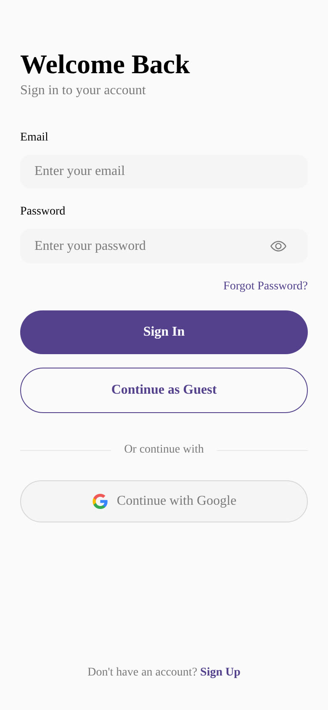
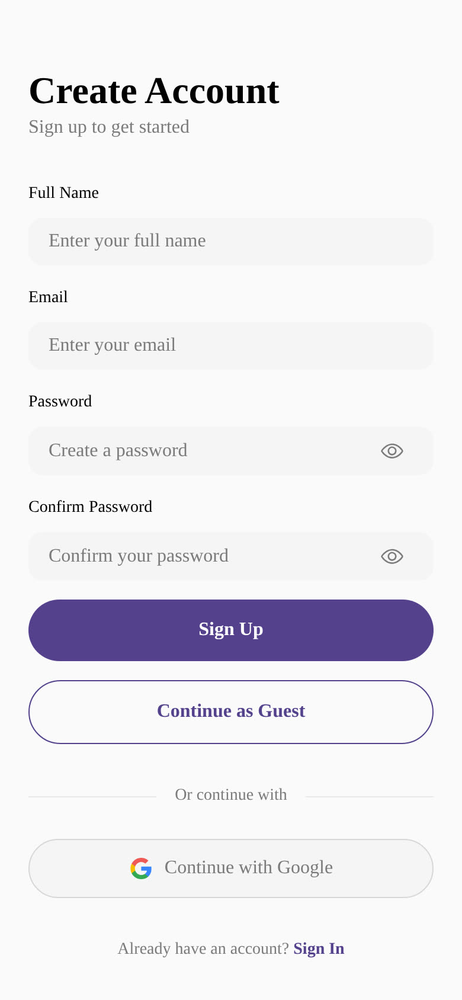
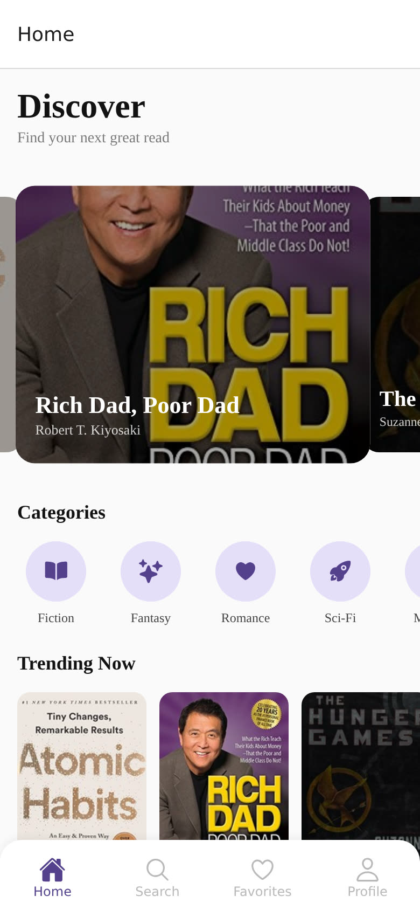
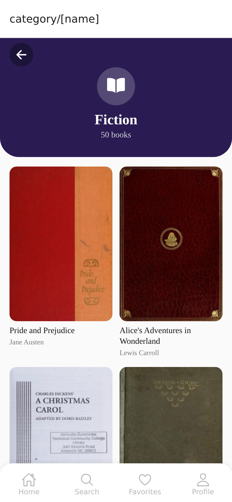
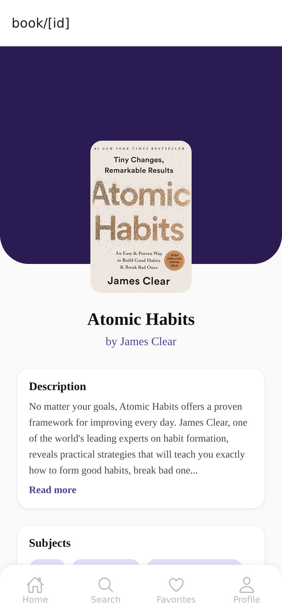
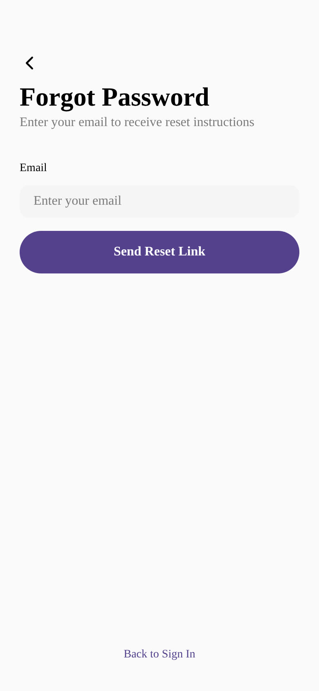

# Bazar

A mobile bookstore app built with React Native and Expo. Browse trending books and new releases from the OpenLibrary API, explore curated categories, and open rich book detail pages, with Firebase email/password authentication and a guest mode.

> Screenshots below are captured from the Expo web preview, so they can differ slightly from the native iOS/Android rendering.

---

## Core Features

- **Onboarding & splash** — branded splash screen followed by a 3-slide onboarding carousel (reanimated carousel) with skip/next navigation.

- **Authentication** — Firebase Auth email/password sign-in and sign-up with inline validation and status feedback, anonymous guest login, and a forgot-password → OTP verification → reset-password flow. A Google sign-in button is present as UI.

  

  

- **Home** — hero carousel of trending books, a category shortcut row (Fiction, Fantasy, Romance, Sci-Fi, Mystery, History, Biography, Self Help), plus horizontal Trending Now and New Releases lists.

  

- **Category browsing** — each category opens a grid of up to 50 books for that subject with a branded header.

  

- **Book details** — cover, title, author and first-publish year, expandable description, subject chips, additional subjects (places, people, times), book metadata, external links, and an editions section.

  

- **Password recovery** — forgot-password, OTP verification, and reset-password screens.

  

- **Data layer** — OpenLibrary REST API (trending, subjects, search, works, editions, authors) through a shared Axios client, cached with TanStack Query (retry, stale-time, garbage-collection tuned).
- **Navigation** — file-based routing with expo-router (typed routes): stack flow for splash → onboarding → auth, and bottom tabs for Home, Search, Favorites, Profile.
- **Theming** — custom color, spacing and typography token system (Open Sans / Roboto) with light/dark color-scheme hooks.

---

## Tech Stack

| Category            | Technology                                             |
| ------------------- | ------------------------------------------------------ |
| **Framework**       | React Native 0.85 + Expo SDK 56                        |
| **Language**        | TypeScript 6                                           |
| **Routing**         | expo-router 6 (file-based, typed routes, React Compiler experiment) |
| **Data Fetching**   | Axios + TanStack Query 5                               |
| **Backend / Auth**  | Firebase Auth 12 (email/password, anonymous)           |
| **API**             | OpenLibrary (openlibrary.org REST API + cover images)  |
| **UI / Animation**  | React Native Reanimated 4, reanimated-carousel, expo-image, expo-glass-effect, @expo/ui |
| **Fonts**           | @expo-google-fonts (Open Sans, Roboto) via expo-font   |
| **Build**           | EAS Build (`eas.json`), expo-dev-client                |
| **Linting**         | ESLint 9 with eslint-config-expo                       |

---

## Getting Started

1. Install dependencies

   ```bash
   npm install
   ```

2. Create a Firebase project with Email/Password and Anonymous sign-in enabled, and set the web API key:

   ```bash
   export EXPO_PUBLIC_FIREBASE_API_KEY=your-api-key
   ```

3. Start the app

   ```bash
   npx expo start
   ```

   Then open it in Expo Go, a development build, or the web preview (`npm run web`).

---

## Roadmap

The following tabs currently ship as placeholder UI and are next in line:

- **Search** — tab exists, search functionality not implemented yet.
- **Favorites** — empty-state screen; no persistence yet.
- **Profile** — static menu UI (edit profile, notifications, privacy, appearance, about, help); actions not wired yet.
- **Google sign-in** — button UI present, provider flow not wired.
